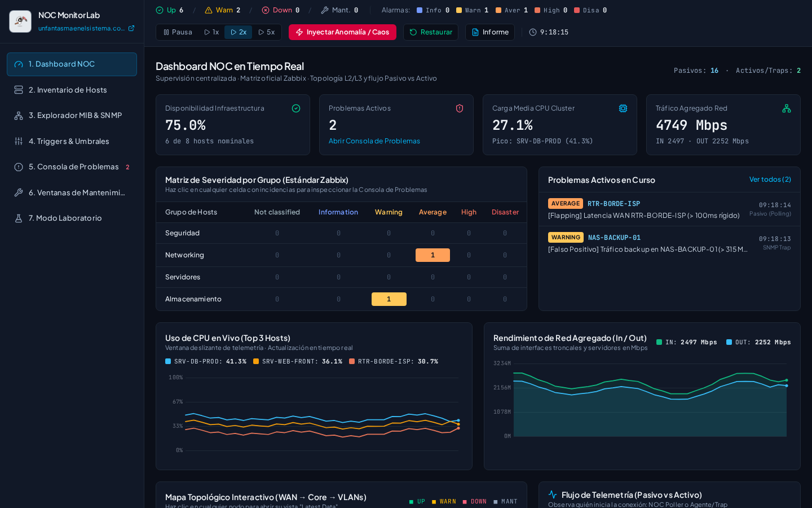
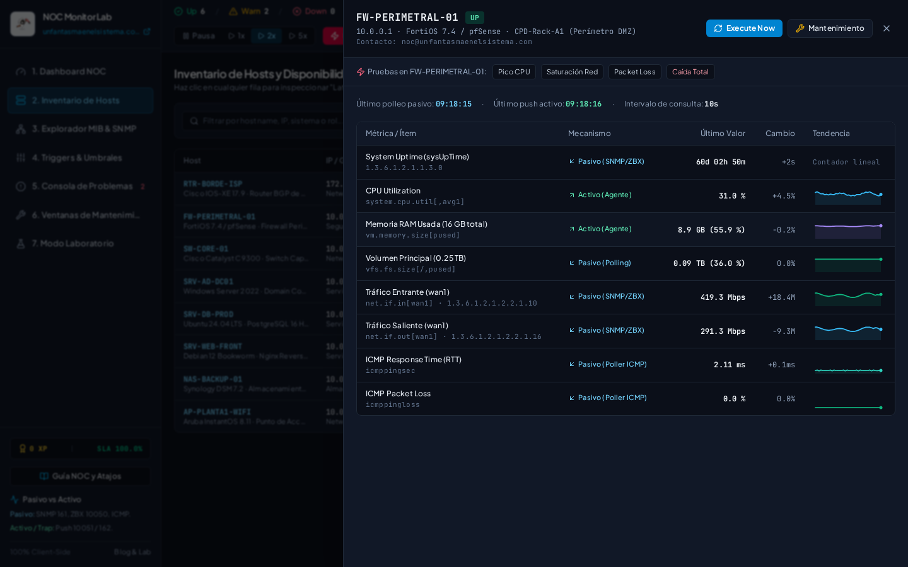
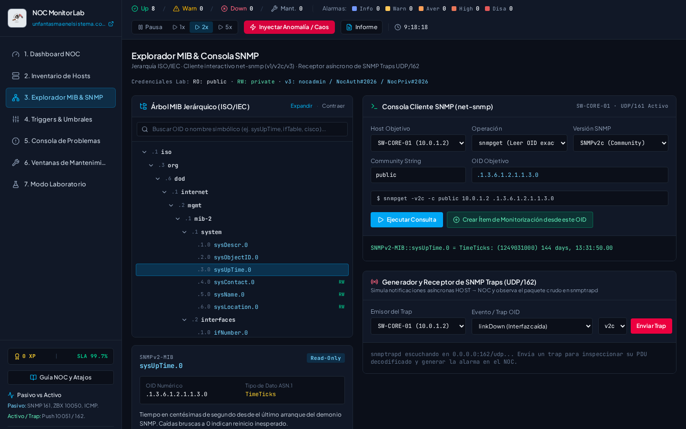
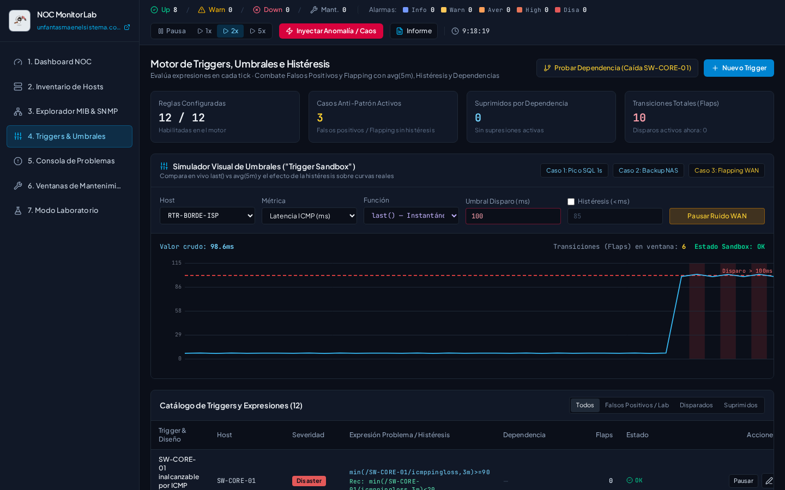
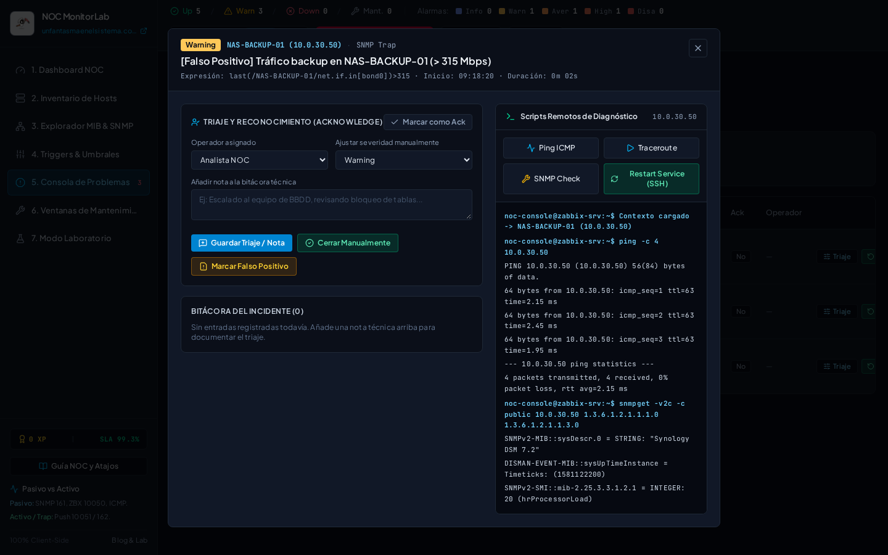
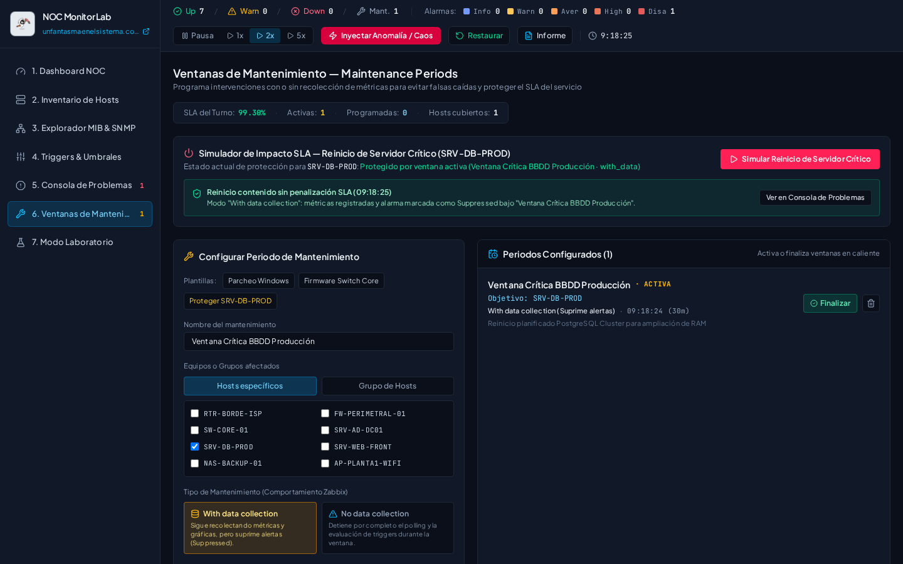
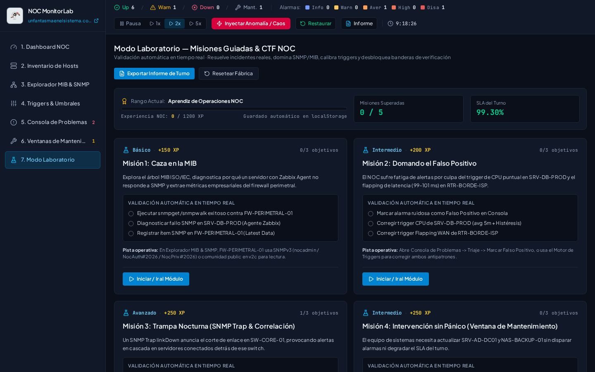
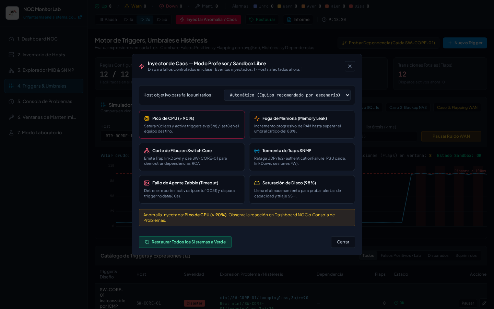

<div align="center">
  
  <h1>NOC Monitor Lab</h1>
  <p>
    <strong>Simulador educativo interactivo de Centro de Operaciones de Red (NOC) estilo Zabbix / Grafana</strong><br />
    100% Client-Side · Sin backend · Listo para GitHub Pages
  </p>

  <p>
    
    
    
    
    
    
  </p>

  <p>
    Proyecto educativo de <a href="https://www.unfantasmaenelsistema.com/" target="_blank" rel="noopener noreferrer">unfantasmaenelsistema.com</a>
  </p>
</div>

---

## Descripción General

**NOC Monitor Lab** es una plataforma web interactiva diseñada para enseñar, practicar y demostrar en clase los fundamentos reales de la monitorización de redes y sistemas (**Zabbix / Nagios / Prometheus / SNMP**) sin necesidad de levantar servidores ni máquinas virtuales.

Incluye un **motor de telemetría en tiempo real**, topología SVG interactiva, simulador completo de comandos **SNMP (`v1` / `v2c` / `v3`)** y **Traps UDP/162**, evaluador de **triggers con histéresis y dependencias (RCA)**, consola de triaje de incidentes con **terminal remota simulada**, **ventanas de mantenimiento**, **5 misiones CTF con validación automática** y un **Inyector de Caos** para demostraciones en directo.

---

## Características Principales

- **Motor de Telemetría Pasiva vs Activa**: distingue visualmente entre *Passive Polling* (`NOC → Host`: SNMP `161/udp`, Zabbix Agent `10050/tcp`, ICMP) y *Active Check / Traps* (`Host → NOC`: Zabbix Agent Activo `10051/tcp`, SNMP Trap `162/udp`).
- **Control de Simulación**: velocidad ajustable (`Pausa`, `1x`, `2x`, `5x`), reloj en tiempo real y ejecución manual inmediata (*Execute Now*).
- **Inyector de Caos (Modo Profesor)**: dispara fallos unitarios o tormentas de eventos (*CPU Spike*, *Memory Leak progresivo*, *Corte de Fibra en Switch Core*, *Tormenta de Traps SNMP*, *Timeout de Agente Zabbix* y *Disco al 98%*).
- **Persistencia & Auditoría**: guardado automático en `localStorage` (con botón **Resetear Fábrica**) y generador de **Informe de Turno NOC** con cálculo de **SLA**, **MTTA** (*Mean Time To Acknowledge*), exportación **JSON**, descarga **HTML imprimible** e impresión directa.
- **Atajos de Teclado y Guía Rápida**: teclas `1–7` para navegar entre módulos, `P` para pausar/reanudar, `C` para abrir el Inyector de Caos y `Esc` para cerrar modales/drawers.

---

## Recorrido por los Módulos (Capturas Reales)

### 1. Dashboard NOC en Tiempo Real
Matriz de severidad oficial de Zabbix (*Not classified*, *Information*, *Warning*, *Average*, *High*, *Disaster*), KPIs de infraestructura, gráficas `<canvas>` multi-serie en vivo, mapa topológico SVG (`WAN → Core → VLANs`) y flujo de telemetría *Pasivo vs Activo*.



---

### 2. Inventario de Hosts & *Latest Data*
Tabla completa de equipos con indicadores de disponibilidad por protocolo (`ZBX`, `SNMP`, `ICMP`, `HTTP`), filtros por grupo/estado/modo, alta/edición de hosts y panel lateral **Latest Data** con *sparklines* e historial por ítem.



---

### 3. Explorador MIB (ISO/IEC) & Consola SNMP
Árbol MIB jerárquico navegable (`.1.3.6.1.2.1` `mib-2` y `.1.3.6.1.4.1` `enterprises` para Cisco, Fortinet y UCD-SNMP), consola `net-snmp` (`snmpget`, `snmpwalk`, `snmptable`, `snmpset` con validación real de comunidades y credenciales `v3 authPriv`), vinculación de nuevos ítems a *Latest Data* y generador/receptor `snmptrapd` en `UDP/162`.



---

### 4. Motor de Triggers, Umbrales e Histéresis
Catálogo de 12 triggers (incluyendo **3 antipatrones didácticos** de falsos positivos y *flapping*), constructor visual de expresiones (`last`, `avg5m`, `min3m`, `max`, `diff`, `nodata60s`), dependencias entre triggers (*Root Cause Analysis*) y **Trigger Sandbox** en vivo para comparar `last()` frente a `avg(5m)` + histéresis.



---

### 5. Consola de Problemas (`Monitoring → Problems`) & Triaje
Tabla en vivo con duración actualizada cada segundo, parpadeo opcional en alarmas nuevas, detección automática de *flapping* / falsos positivos, indicador naranja `Suppressed` durante mantenimientos y **Modal de Triaje** con *Acknowledge*, asignación de operador, bitácora técnica, asistente de calibración y consola terminal de scripts remotos (`Ping`, `Traceroute`, `SNMP Check`, `Restart Service SSH`).



---

### 6. Ventanas de Mantenimiento & Simulador de Impacto SLA
Programación de periodos de mantenimiento por hosts o grupos en modo **With data collection** (mantiene gráficas y suprime alertas sin penalizar SLA) o **No data collection** (detiene polling y evaluación), acompañado de un simulador de reinicio crítico sobre `SRV-DB-PROD`.



---

### 7. Modo Laboratorio (Misiones CTF) & Inyector de Caos
5 misiones guiadas evaluadas automáticamente en tiempo real con progreso por objetivos, sistema de **XP NOC**, rangos operativos, reto contrarreloj de 180s y obtención de banderas de verificación (`NOC{...}`).



<details>
<summary>Ver captura del Panel Inyector de Caos (Modo Profesor)</summary>



</details>

---

## Infraestructura Simulada y Credenciales de Laboratorio

| Hostname | IP | Rol / Sistema Operativo | Protocolos |
| :--- | :--- | :--- | :--- |
| `RTR-BORDE-ISP` | `172.16.0.1` | Router BGP de borde (`Cisco IOS-XE 17.9`) | SNMPv3, ICMP |
| `FW-PERIMETRAL-01` | `10.0.0.1` | Firewall perimetral (`FortiOS 7.4 / pfSense`) | SNMPv3, ICMP |
| `SW-CORE-01` | `10.0.1.2` | Switch Capa 3 (`Cisco Catalyst C9300`) | SNMPv2c, ICMP |
| `SRV-AD-DC01` | `10.0.10.10` | Domain Controller (`Windows Server 2022`) | ZBX Pasivo/Activo, SNMP |
| `SRV-DB-PROD` | `10.0.10.20` | Cluster PostgreSQL 16 (`Ubuntu 24.04 LTS`) | ZBX Activo (sin SNMP) |
| `SRV-WEB-FRONT` | `10.0.20.15` | Reverse Proxy Nginx (`Debian 12 Bookworm`) | ZBX, HTTP Check |
| `NAS-BACKUP-01` | `10.0.30.50` | Almacenamiento iSCSI (`Synology DSM 7.2`) | SNMPv2c, ICMP |
| `AP-PLANTA1-WIFI` | `10.0.40.10` | Punto de Acceso Wi-Fi 6E (`Aruba InstantOS`) | SNMPv2c, ICMP |

**Credenciales SNMP del Lab:**
- **SNMPv1 / v2c Read-Only:** `public`
- **SNMPv1 / v2c Read-Write (`snmpset`):** `private`
- **SNMPv3 (`authPriv`):** Usuario `nocadmin` · Auth `NocAuth#2026` · Priv `NocPriv#2026`

---

## Misiones CTF y Validación Automática

| Misión | Dificultad | XP | Objetivo Principal |
| :--- | :--- | :--- | :--- |
| **1. Caza en la MIB** | Básico | +150 | Consultar `FW-PERIMETRAL-01` vía SNMP, diagnosticar la ausencia de SNMP en `SRV-DB-PROD` y registrar un ítem en *Latest Data*. |
| **2. Domando el Falso Positivo** | Intermedio | +200 | Marcar falsos positivos en Consola de Problemas y corregir triggers de `SRV-DB-PROD` y `RTR-BORDE-ISP` con `avg(5m)` + histéresis. |
| **3. Trampa Nocturna** | Avanzado | +250 | Analizar un Trap `linkDown` en `SW-CORE-01`, validar la dependencia RCA de triggers hijos y documentar el *Ack* en la causa raíz. |
| **4. Intervención sin Pánico** | Intermedio | +250 | Proteger `SRV-AD-DC01` y `NAS-BACKUP-01` con una ventana *With data collection* antes de ejecutar la actualización simulada (`SLA >= 99.5%`). |
| **5. Turno de Guardia en Crisis** | Experto | +350 | Contrarreloj (180s): reconocer Trap `authenticationFailure`, resolver disco al 98% en `SRV-DB-PROD` y descartar distracción del NAS. |

---

## Instalación Local y Desarrollo

Requisitos previos: **Node.js 20+** y **npm**.

```bash
# 1. Clonar el repositorio
git clone https://github.com/<tu-usuario>/noc-monitor-lab.git
cd noc-monitor-lab

# 2. Instalar dependencias
npm install

# 3. Arrancar servidor de desarrollo (http://localhost:3000)
npm run dev

# 4. Comprobar tipos y generar build de producción (carpeta dist/)
npm run lint
npm run build
```

---

## Despliegue en GitHub Pages

El repositorio ya incluye toda la configuración necesaria para **GitHub Pages** (`base: './'` en `vite.config.ts`, `.nojekyll` en `public/` y workflow oficial):

1. Sube el proyecto a tu repositorio de GitHub en la rama `main`.
2. En **Settings → Pages → Build and deployment**, selecciona **GitHub Actions** como fuente (*Source*).
3. El flujo `.github/workflows/deploy.yml` ejecutará `npm run lint`, `npm run build` y publicará automáticamente el contenido estático de `dist/`.

---

## Estructura del Proyecto

```text
├── .github/workflows/deploy.yml   # CI/CD automático para GitHub Pages
├── docs/screenshots/              # Capturas reales de la aplicación
├── public/                        # Logo y .nojekyll
├── src/
│   ├── components/                # Vistas de los 7 módulos y modales (Triaje, Caos, Informe, Guía)
│   ├── data/                      # Base de hosts, árbol MIB ISO/IEC, triggers y misiones CTF
│   ├── engine/                    # Motor de telemetría, evaluación de triggers y simulador SNMP
│   ├── state/                     # Store central con useReducer y persistencia localStorage
│   ├── types/                     # Definiciones estrictas TypeScript
│   └── App.tsx                    # Orquestación principal y atajos de teclado
├── LICENSE                        # Licencia MIT
└── vite.config.ts                 # Configuración Vite con rutas relativas para GitHub Pages
```

---

## Licencia

Distribuido bajo licencia **MIT**. Consulta el archivo [LICENSE](LICENSE) para más detalles.
